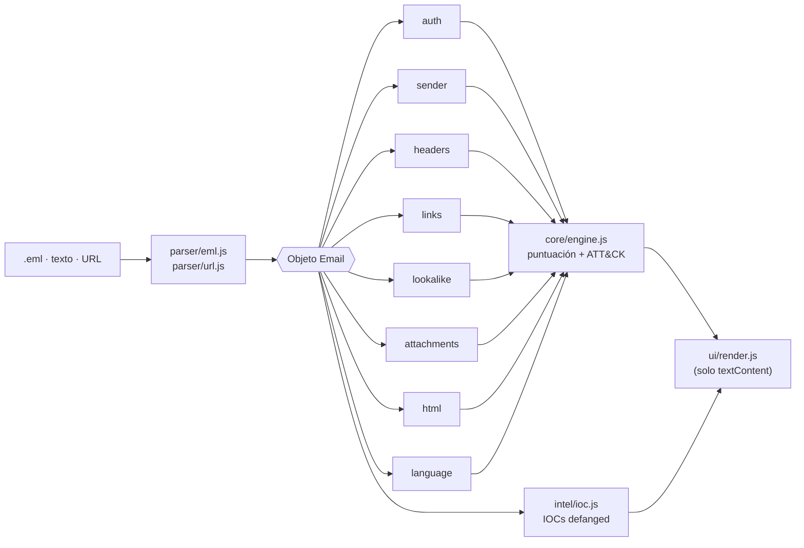

<div align="center">


# PhishLens

**¿Es phishing? Descúbrelo y entiende por qué, sin que tu email salga del navegador.**

[](https://github.com/ManzaXx/ProyectosPersonales/actions/workflows/phishlens-tests.yml)


[](LICENSE)

</div>


PhishLens analiza un email (archivo `.eml` o texto pegado) o una URL y devuelve una **puntuación de riesgo de 0 a 100**. Explica cada señal en lenguaje claro, la relaciona con su técnica de **MITRE ATT&CK** y extrae los **indicadores de compromiso (IOCs)** listos para compartir con un equipo de seguridad.

Todo se ejecuta en tu navegador. No hay servidor, cookies ni analítica, y una Content-Security-Policy estricta impide cualquier conexión a terceros.

## ✨ Funcionalidades

- **Dos niveles de detalle**: el **modo sencillo** da el veredicto en una frase («No te fíes: es phishing»), tres pasos de qué hacer y las señales en lenguaje llano; el **modo analista** tiene navegación lateral por Resumen, Señales, Vista segura, Autenticación, Cabeceras y ruta, IOCs y ATT&CK, con la vista en la URL (`#analista/senales`).
- **10 detectores y 72 reglas**: autenticación, remitente, cabeceras, ruta, estructura MIME, enlaces, dominios parecidos, adjuntos, HTML y lenguaje. Cada regla tiene su texto llano y su técnica ATT&CK.
- **Informe explicado**: nota con semáforo, motivo principal, confianza del análisis, riesgo por categoría, combinaciones peligrosas y recomendaciones de qué hacer.
- **Vista segura**: el email como texto plano, sin enlaces activos y con las frases de ingeniería social resaltadas.
- **Ruta del email**: reconstruye los saltos `Received` con sus IPs.
- **IOCs defanged** (`hxxp://evil[.]xyz`) con botón de copiar para pegarlos en un ticket.
- **MITRE ATT&CK**: cada señal enlazada a su técnica (T1566.002, T1036.007, T1684.001…), con su táctica y el motivo, según ATT&CK 20.1.
- **Desenvuelve enlaces** de Microsoft Safe Links, Google y LinkedIn para analizar el destino real.
- **Exportar** (JSON, copiar IOCs, imprimir) desde un menú accesible con teclado.
- **Sistema de diseño propio** ([docs/design-system.md](docs/design-system.md)): tokens con contraste comprobado en claro y oscuro, objetivos táctiles de 44 px y sin scroll horizontal a 360 px, comprobados en un Chromium real.
- **10 emails de ejemplo** que se cargan con un clic.

| Modo sencillo (oscuro) | Móvil | Email legítimo |
|---|---|---|
|  |  |  |

| Modo analista: resumen | Señales | Autenticación |
|---|---|---|
|  |  |  |

| Vista segura | Cabeceras y ruta | IOCs | ATT&CK |
|---|---|---|---|
|  |  |  |  |

## 🔍 Qué detecta

| Detector | Señales | ATT&CK |
|---|---|---|
| **Autenticación** | SPF, DKIM y DMARC con su **estado** (verificado por PhishLens, declarado por el receptor, declarado sin confirmar, no verificable sin DNS); `Authentication-Results` **falsificadas**; DMARC sin alineación; cuerpo modificado tras la firma DKIM (hash `bh=` comprobado en local); firma DKIM y SPF verificables pegando la clave o el registro | T1684.002 |
| **Remitente** | `Reply-To` y `Return-Path` de otro dominio, marca suplantada desde un dominio ajeno o un correo gratuito, letras cirílicas o griegas camufladas (`Pаypal`), caracteres invisibles, nombre visible con otra dirección (`"soporte@paypal.com" <x@evil.test>`), `Sender` de otro dominio sin firmar | T1684.001, T1027 |
| **Cabeceras técnicas** | `Message-ID` de otro dominio, falta `Date` o `Message-ID`, fecha futura, `X-Mailer` de kits de phishing (PHPMailer…), varios `From` o cabeceras únicas repetidas | T1684.002 (varios `From`) |
| **Ruta del correo** | IP privada en el salto de entrada, horas que retroceden, entrega de más de 24 h, más de 25 saltos, servidor que dice ser una marca (HELO) sin serlo | T1684.002 |
| **Enlaces** | Texto que muestra otro dominio, IPs, acortadores, `@` que oculta el host, punycode, TLD baratos, login sin HTTPS, marca en la ruta, descarga directa de ejecutables, enlaces de seguimiento | T1566.002, T1204.001 |
| **Dominios parecidos** | Levenshtein y homoglifos (`0→o`, `1→l`, `rn→m`) frente a 37 marcas (22 españolas verificadas), confusables de Unicode UTS #39, dominios con alfabetos mezclados o enteros en cirílico (`аррӏе.com`), homógrafos con letras latinas raras o de otros alfabetos (`ɑpple.com`), subdominios engañosos (`paypal.com.cuenta-segura.test`), marca + palabra de acceso (combosquatting) | T1583.001 |
| **Adjuntos** | Ejecutables, doble extensión (`factura.pdf.exe`), nombre invertido con RLO, macros, comprimidos | T1566.001, T1204.002, T1036.007, T1036.002 |
| **Contenido HTML** | Formularios dentro del email, JavaScript o iframes, enlaces `data:`, texto oculto para burlar filtros, emails que son solo una imagen | T1598, T1059.007, T1027 |
| **Lenguaje** | Urgencia, amenazas, premios y peticiones de credenciales, en español e inglés | T1204, T1598 |

### Puntuación

La nota (0–100) combina seis categorías: Autenticación, Remitente, Enlaces, Adjuntos, Lenguaje e Infraestructura.

- Cada señal pesa según su gravedad y su fiabilidad, y cada categoría satura: diez enlaces raros no valen más que uno muy grave.
- Las **combinaciones peligrosas** suben la nota, por ejemplo suplantación de marca con autenticación fallida.
- Una firma DKIM verificada rebaja las señales blandas.

Aparte de la nota, el informe da la **confianza del análisis** (alta, media o baja) según lo que se pudo comprobar. Detalle y ejemplo resuelto en [docs/scoring.md](docs/scoring.md).

| Nota | Veredicto |
|---|---|
| 0–24 | 🟢 Probablemente legítimo |
| 25–59 | 🟠 Sospechoso |
| 60–79 | 🔴 Probable phishing |
| 80–100 | 🟣 Phishing casi seguro |

## 🚀 Pruébalo

```bash
git clone https://github.com/ManzaXx/ProyectosPersonales.git
cd ProyectosPersonales/proyectoCiber
python -m http.server 8080      # o: npx serve .
# abre http://localhost:8080
```

Pulsa cualquiera de los ejemplos o arrastra tu propio `.eml` a la página. En Gmail se descarga con <kbd>⋮</kbd> → *Descargar mensaje*. También puedes copiar el original desde *Mostrar original* y pegarlo.

Los ejemplos son ficticios: los dominios de los atacantes usan el TLD reservado `.test` y no existen.

## 🏗️ Arquitectura

Detalle de capas, modelos de datos y límites en [docs/architecture.md](docs/architecture.md); decisiones en [docs/adr/](docs/adr/).



```
proyectoCiber/
├── index.html               # Página única con CSP estricta
├── assets/                  # CSS (tema claro/oscuro), favicon e imagen para compartir
├── src/
│   ├── lib/                 # Utilidades puras: SHA-256, límites, texto seguro
│   ├── data/                # Marcas, listas de referencia, patrones y mapa MITRE ATT&CK
│   ├── parser/              # eml.js (RFC 5322 + MIME), received.js, html.js (sin DOM), url.js
│   ├── detectors/           # 10 detectores con la misma interfaz: detect(email) -> Finding[]
│   ├── intel/               # Extracción y "defang" de indicadores, hashes de adjuntos
│   ├── core/                # Modelo de hallazgo, motor y recomendaciones
│   └── ui/                  # Render del informe, resaltado y controlador de la página
├── docs/                    # Arquitectura, ADRs, especificaciones y planes
├── SECURITY.md              # Modelo de amenazas y mitigaciones
├── samples/                 # 7 emails .eml de ejemplo
└── tests/                   # unit/ y helpers/ con node:test
```

### Decisiones técnicas

- **JavaScript puro con módulos ES**, sin frameworks ni compilación: el código que se lee es el que se ejecuta.
- **El motor no toca el DOM**, así que todo el análisis se prueba en Node con `node --test`, sin dependencias.
- **El email nunca se interpreta como HTML.** Se inserta con `textContent`, los enlaces del email no son clicables y el HTML se recorre con un escáner propio, sin crear nodos.
- **Resistente a emails maliciosos.** El parser trabaja en tiempo lineal y los regex tienen cuantificadores acotados. Hay tests que comprueban que miles de etiquetas sin cerrar, paréntesis o puntos no bloquean la pestaña (ReDoS).
- **Detectores aislados.** Si uno falla, el motor lo registra y sigue con el resto.
- **Seguridad auditada.** Trusted Types, CSP sin `unsafe-inline`, límites contra DoS, protección contra contaminación de prototipos y clickjacking. Ver [SECURITY.md](SECURITY.md).
- **Privacidad por diseño.** La CSP (`connect-src 'none'`, `script-src 'self'`, sin `unsafe-inline`) impide enviar datos fuera aunque hubiera un fallo, y un test en Chromium real comprueba que analizar un correo no hace ni una petición fuera del origen.

## 🧪 Tests

```bash
cd proyectoCiber
node --test                 # unitarios, golden, fuzzing (2.000 casos), diferenciales y rendimiento
npm run fuzz                # 20.000 casos de fuzzing
npm run bench               # reescribe docs/benchmark.md
npm ci && npx playwright install chromium && npm run test:e2e   # privacidad y accesibilidad en Chromium
```

GitHub Actions ejecuta todo en cada push (`.github/workflows/phishlens-tests.yml`), más `npm audit`, y Dependabot vigila las dependencias de test y las Actions. Los tests cubren el parser, cada detector con casos positivos y negativos, el motor, los IOCs, el mapa ATT&CK, las 10 muestras de principio a fin y la resistencia a entradas maliciosas. La [matriz de cobertura](docs/coverage-matrix.md) dice dónde se prueba cada regla; el [modelo de amenazas](docs/threat-model.md) y la [auditoría](docs/security-audit.md), qué protege cada test.

## 🌐 Publicar la demo

El workflow `.github/workflows/phishlens-pages.yml` publica la web en GitHub Pages:

1. Elige *GitHub Actions* como origen en *Settings → Pages*.
2. Lanza el workflow a mano desde la pestaña *Actions*.

GitHub Pages en un repositorio privado requiere GitHub Pro. Sin Pro, puedes hacer el repositorio público o copiar `proyectoCiber/` a un repositorio público.

## ⚠️ Limitaciones

- Son heurísticas: una nota baja **no garantiza** que un email sea seguro, y un email legítimo mal configurado puede salir sospechoso.
- No consulta servicios externos (listas negras, WHOIS, VirusTotal), porque eso exigiría enviar datos fuera del navegador.
- Sin red no consulta DNS: la firma DKIM y el SPF solo se verifican si pegas la clave o el registro. Detalles en [docs/limitations.md](docs/limitations.md).
- No analiza el contenido de los adjuntos, solo su nombre y tipo, ni el formato `.msg` de Outlook.

## 🗺️ Próximos pasos

- [x] Verificación de firmas DKIM con WebCrypto (2.2)
- [ ] Extensión de navegador para analizar el email abierto en Gmail u Outlook
- [ ] Modo por lotes para analizar varios `.eml` a la vez
- [ ] Exportar IOCs en formato STIX 2.1

## 📄 Licencia y aviso

[MIT](LICENSE) © 2026 Pablo Manzanedo.

PhishLens es un proyecto educativo de ciberseguridad defensiva. Si recibes un email sospechoso, contacta con la empresa por un canal oficial y repórtalo. En España puedes llamar a INCIBE al **017**.

---

<div align="center">Hecho por <b>Pablo Manzanedo</b> · <a href="https://github.com/ManzaXx">GitHub</a></div>
