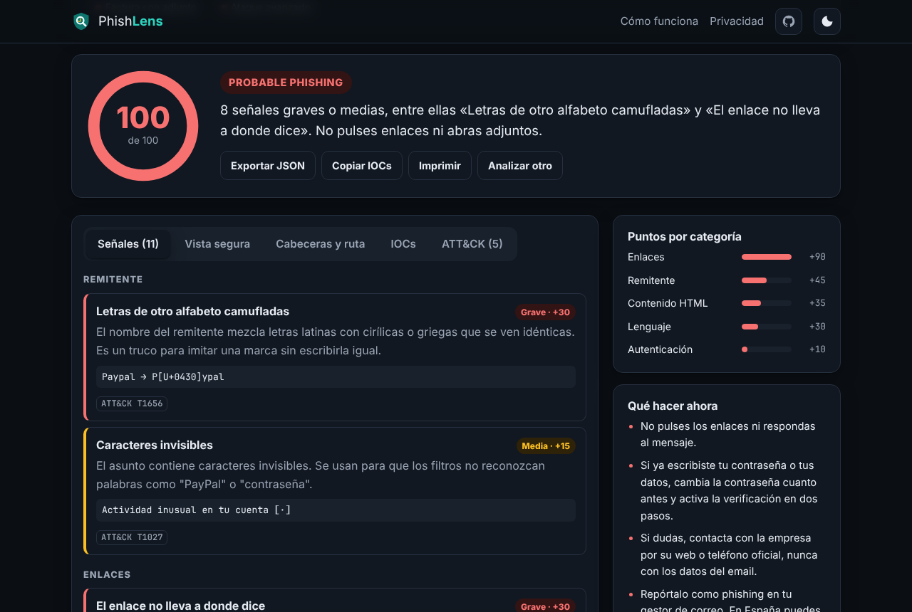
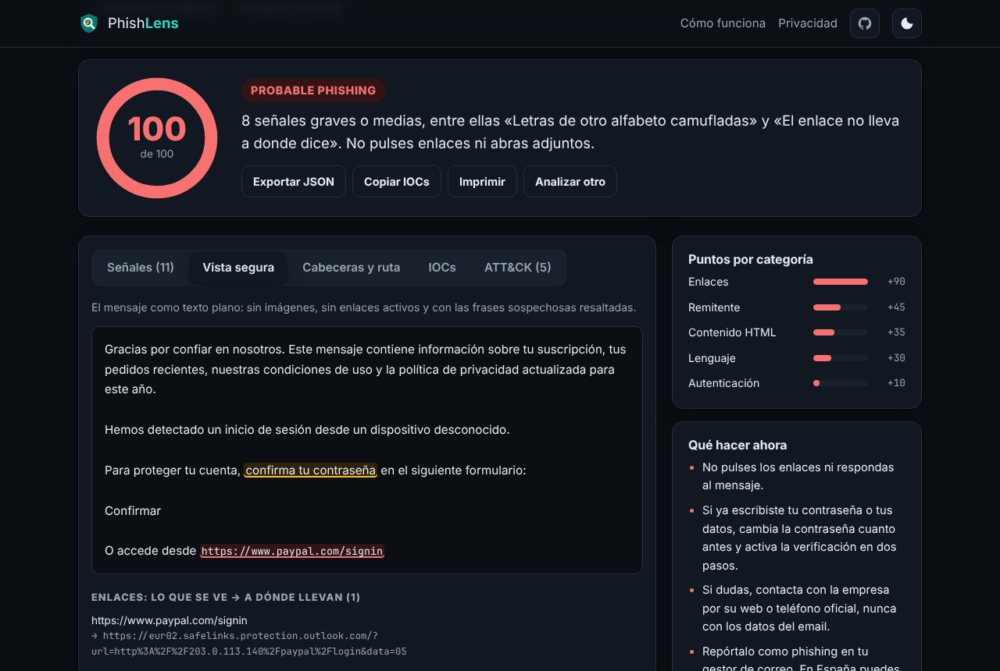
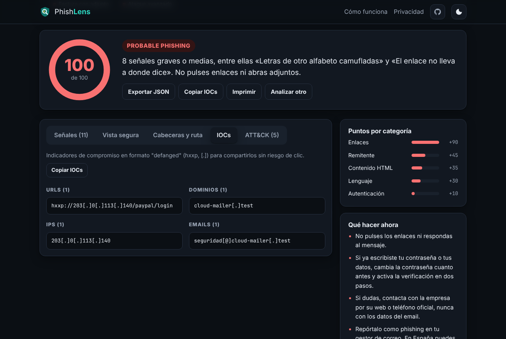
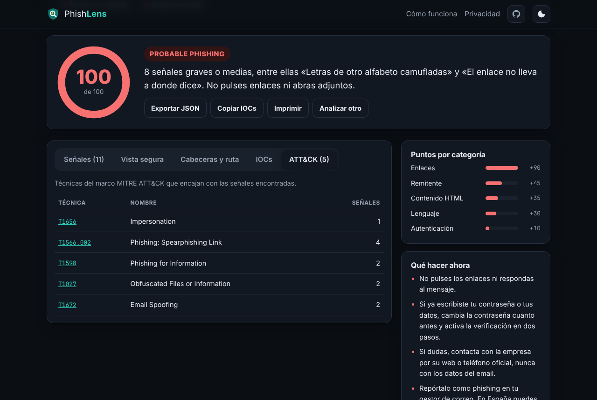
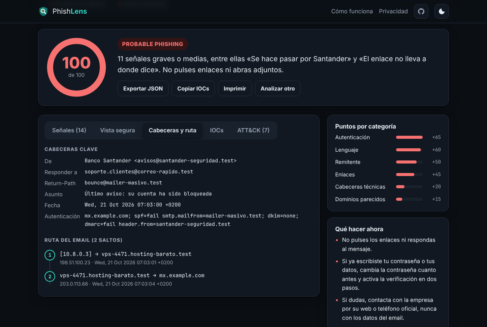
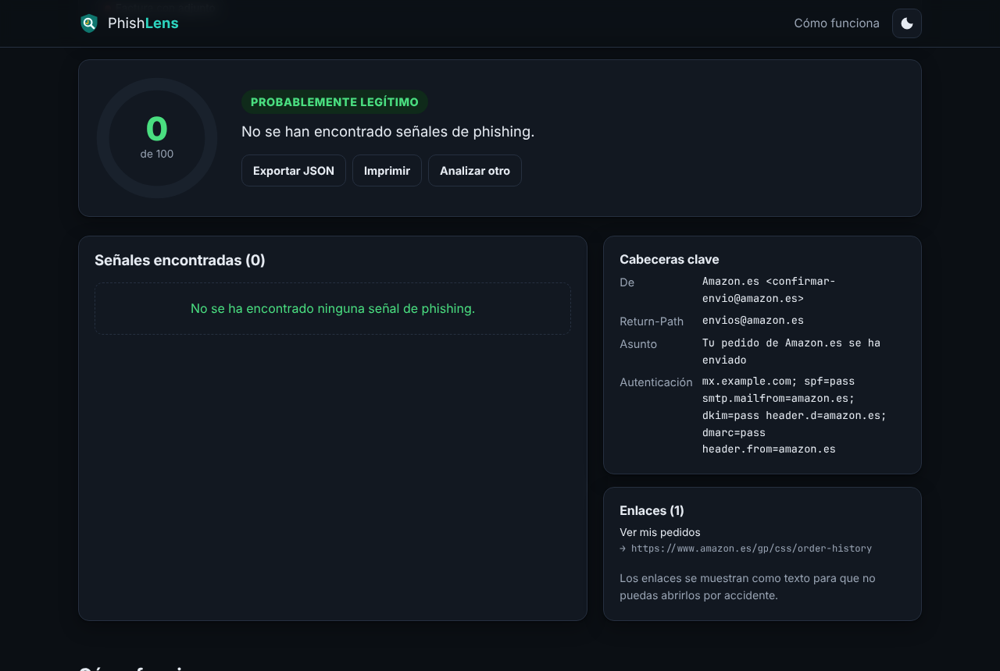
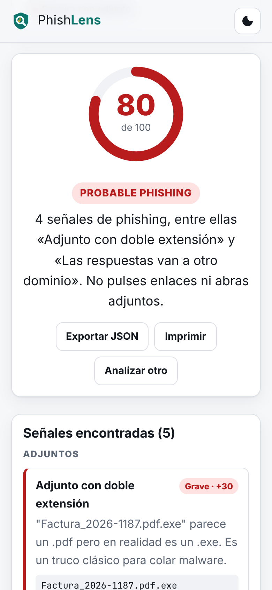
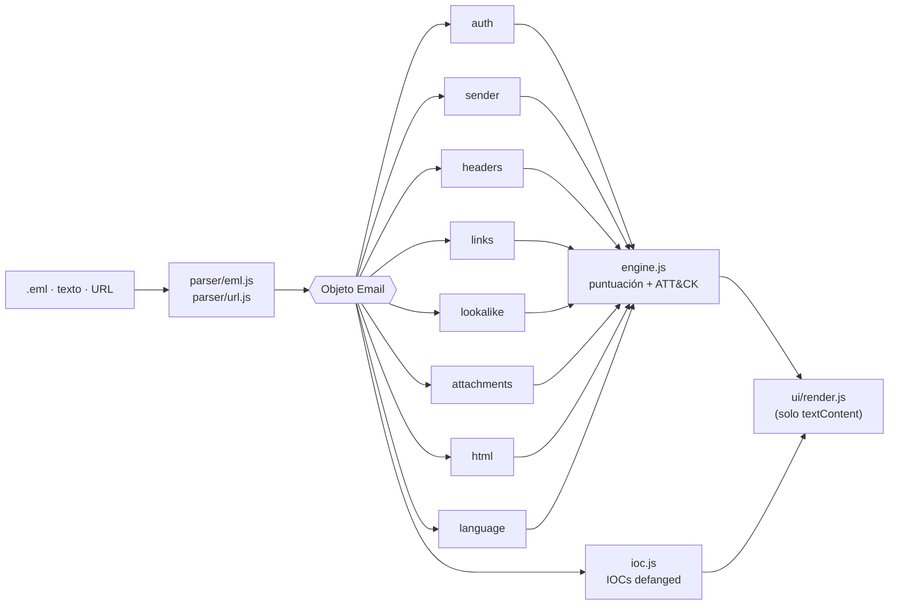

<div align="center">


# PhishLens

**¿Es phishing? Descúbrelo y entiende por qué, sin que tu email salga del navegador.**

[](https://github.com/ManzaXx/ProyectosPersonales/actions/workflows/phishlens-tests.yml)


[](LICENSE)

</div>



PhishLens analiza un email (archivo `.eml` o texto pegado) o una URL y devuelve una **puntuación de riesgo de 0 a 100**. Explica cada señal en lenguaje claro, la relaciona con su técnica de **MITRE ATT&CK** y extrae los **indicadores de compromiso (IOCs)** listos para compartir con un equipo de seguridad.

Todo se ejecuta en tu navegador. No hay servidor, cookies ni analítica, y una Content-Security-Policy estricta impide cualquier conexión a terceros.

## ✨ Funcionalidades

- **8 detectores y más de 40 señales**: autenticación, remitente, cabeceras, enlaces, dominios parecidos, adjuntos, HTML y lenguaje.
- **Informe explicado**: nota con semáforo, resumen, desglose de puntos por categoría y recomendaciones de qué hacer.
- **Vista segura**: el email como texto plano, sin enlaces activos y con las frases de ingeniería social resaltadas.
- **Ruta del email**: reconstruye los saltos `Received` con sus IPs.
- **IOCs defanged** (`hxxp://evil[.]xyz`) con botón de copiar para pegarlos en un ticket.
- **MITRE ATT&CK**: cada señal enlazada a su técnica (T1566.002, T1036.007, T1656…).
- **Desenvuelve enlaces** de Microsoft Safe Links, Google y LinkedIn para analizar el destino real.
- **Exportar a JSON** e imprimir el informe.
- **Tema claro y oscuro**, accesible con teclado y adaptado a móvil.
- **7 emails de ejemplo** que se cargan con un clic.

| Vista segura | IOCs | MITRE ATT&CK |
|---|---|---|
|  |  |  |

| Cabeceras y ruta | Email legítimo | Móvil |
|---|---|---|
|  |  |  |

## 🔍 Qué detecta

| Detector | Señales | ATT&CK |
|---|---|---|
| **Autenticación** | SPF, DKIM y DMARC en `fail`, `softfail` o `none`; falta `Authentication-Results` | T1672 |
| **Remitente** | `Reply-To` y `Return-Path` de otro dominio, marca suplantada desde un dominio ajeno o un correo gratuito, letras cirílicas o griegas camufladas (`Pаypal`), caracteres invisibles | T1656, T1027 |
| **Cabeceras técnicas** | `Message-ID` de otro dominio, falta `Date` o `Message-ID`, fecha futura, `X-Mailer` de kits de phishing (PHPMailer…) | T1566 |
| **Enlaces** | Texto que muestra otro dominio, IPs, acortadores, `@` que oculta el host, punycode, TLD baratos, login sin HTTPS, marca en la ruta, descarga directa de ejecutables, enlaces de seguimiento | T1566.002 |
| **Dominios parecidos** | Levenshtein y homoglifos (`0→o`, `1→l`, `rn→m`) frente a 15 marcas muy suplantadas, marca dentro de un dominio ajeno | T1583.001 |
| **Adjuntos** | Ejecutables, doble extensión (`factura.pdf.exe`), nombre invertido con RLO, macros, comprimidos | T1566.001, T1036.007, T1036.002 |
| **Contenido HTML** | Formularios dentro del email, JavaScript o iframes, enlaces `data:`, texto oculto para burlar filtros, emails que son solo una imagen | T1598, T1059.007, T1027 |
| **Lenguaje** | Urgencia, amenazas, premios y peticiones de credenciales, en español e inglés | T1204, T1598 |

### Puntuación

Cada señal suma puntos según su gravedad: **leve 5**, **media 15** y **grave 30**. La nota máxima es 100.

| Nota | Veredicto |
|---|---|
| 0–24 | 🟢 Probablemente legítimo |
| 25–59 | 🟠 Sospechoso |
| 60–100 | 🔴 Probable phishing |

## 🚀 Pruébalo

```bash
git clone https://github.com/ManzaXx/ProyectosPersonales.git
cd ProyectosPersonales/proyectoCiber
python -m http.server 8080      # o: npx serve .
# abre http://localhost:8080
```

Pulsa cualquiera de los ejemplos o arrastra tu propio `.eml` a la página. En Gmail se descarga con <kbd>⋮</kbd> → *Descargar mensaje*. También puedes copiar el original desde *Mostrar original* y pegarlo.

Los ejemplos son ficticios: los dominios de los atacantes usan el TLD reservado `.test` y no existen.

## 🏗️ Arquitectura



```
proyectoCiber/
├── index.html               # Página única con CSP estricta
├── assets/                  # CSS (tema claro/oscuro), favicon e imagen para compartir
├── src/
│   ├── parser/
│   │   ├── eml.js           # RFC 5322 + MIME: cabeceras plegadas, multipart, base64, QP, RFC 2047/2231
│   │   └── url.js           # URLs, dominio registrable y desenvoltura de Safe Links
│   ├── detectors/           # 8 detectores con la misma interfaz: detect(email) -> Finding[]
│   ├── data/                # Marcas, listas de referencia, patrones y mapa MITRE ATT&CK
│   ├── engine.js            # Ejecuta los detectores, puntúa y arma el informe
│   ├── ioc.js               # Extracción y "defang" de indicadores
│   ├── advice.js            # Recomendaciones según el veredicto
│   └── ui/                  # Render del informe, resaltado y controlador de la página
├── SECURITY.md              # Modelo de amenazas y mitigaciones
├── samples/                 # 7 emails .eml de ejemplo
└── tests/                   # 142 tests con node:test
```

### Decisiones técnicas

- **JavaScript puro con módulos ES**, sin frameworks ni compilación: el código que se lee es el que se ejecuta.
- **El motor no toca el DOM**, así que todo el análisis se prueba en Node con `node --test`, sin dependencias.
- **El email nunca se interpreta como HTML.** Se inserta con `textContent`, los enlaces del email no son clicables y el HTML se recorre con un escáner propio, sin crear nodos.
- **Resistente a emails maliciosos.** El parser trabaja en tiempo lineal y los regex tienen cuantificadores acotados. Hay tests que comprueban que miles de etiquetas sin cerrar, paréntesis o puntos no bloquean la pestaña (ReDoS).
- **Detectores aislados.** Si uno falla, el motor lo registra y sigue con el resto.
- **Seguridad auditada.** Trusted Types, CSP sin `unsafe-inline`, límites contra DoS, protección contra contaminación de prototipos y clickjacking. Ver [SECURITY.md](SECURITY.md).
- **Privacidad por diseño.** La CSP (`connect-src 'self'`, `script-src 'self'`, sin `unsafe-inline`) impide enviar datos fuera aunque hubiera un fallo.

## 🧪 Tests

```bash
cd proyectoCiber
node --test
```

GitHub Actions ejecuta los 142 tests en cada push (`.github/workflows/phishlens-tests.yml`). Cubren el parser, cada detector con casos positivos y negativos, el motor, los IOCs, el mapa ATT&CK, los 7 ejemplos de principio a fin y la resistencia a entradas maliciosas.

## 🌐 Publicar la demo

El workflow `.github/workflows/phishlens-pages.yml` publica la web en GitHub Pages:

1. Elige *GitHub Actions* como origen en *Settings → Pages*.
2. Lanza el workflow a mano desde la pestaña *Actions*.

GitHub Pages en un repositorio privado requiere GitHub Pro. Sin Pro, puedes hacer el repositorio público o copiar `proyectoCiber/` a un repositorio público.

## ⚠️ Limitaciones

- Son heurísticas: una nota baja **no garantiza** que un email sea seguro, y un email legítimo mal configurado puede salir sospechoso.
- No consulta servicios externos (listas negras, WHOIS, VirusTotal), porque eso exigiría enviar datos fuera del navegador.
- No verifica criptográficamente las firmas DKIM: se fía de lo que dice `Authentication-Results`.
- No analiza el contenido de los adjuntos, solo su nombre y tipo, ni el formato `.msg` de Outlook.

## 🗺️ Próximos pasos

- [ ] Verificación de firmas DKIM con WebCrypto
- [ ] Extensión de navegador para analizar el email abierto en Gmail u Outlook
- [ ] Modo por lotes para analizar varios `.eml` a la vez
- [ ] Exportar IOCs en formato STIX 2.1

## 📄 Licencia y aviso

[MIT](LICENSE) © 2026 Pablo Manzanedo.

PhishLens es un proyecto educativo de ciberseguridad defensiva. Si recibes un email sospechoso, contacta con la empresa por un canal oficial y repórtalo. En España puedes llamar a INCIBE al **017**.

---

<div align="center">Hecho por <b>Pablo Manzanedo</b> · <a href="https://github.com/ManzaXx">GitHub</a></div>
