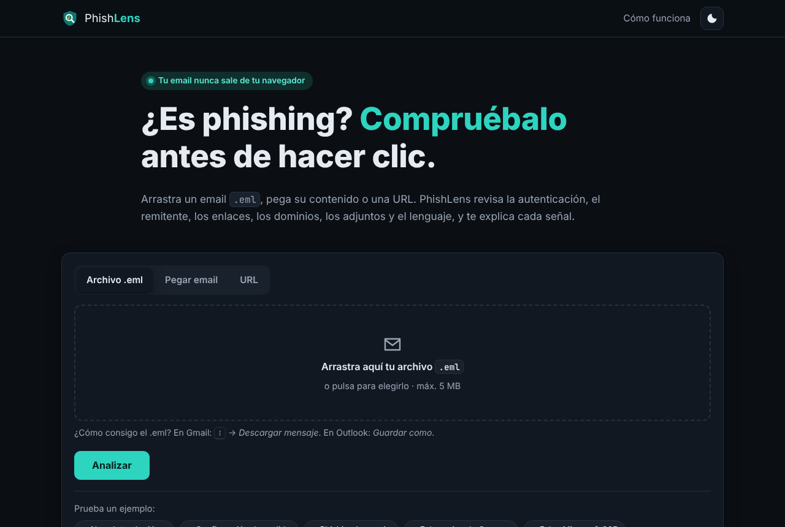

# PhishLens · Analizador de phishing

> ¿Es phishing? Compruébalo antes de hacer clic, sin que tu email salga de tu navegador.

PhishLens analiza un email (archivo `.eml`, texto pegado) o una URL y devuelve una **puntuación de riesgo de 0 a 100** con cada señal explicada en lenguaje claro: autenticación SPF/DKIM/DMARC, remitente suplantado, enlaces engañosos, dominios que imitan marcas, adjuntos peligrosos y lenguaje de ingeniería social.

Todo se ejecuta **en el navegador**. No hay servidor ni cookies ni analítica, y la página tiene una Content-Security-Policy que bloquea cualquier petición a terceros.


| Inicio | Email legítimo | Móvil |
|---|---|---|
|  |  |  |

## Qué detecta

| Detector | Qué comprueba | Ejemplo |
|---|---|---|
| **Autenticación** | Resultados SPF, DKIM y DMARC de la cabecera `Authentication-Results` | `dmarc=fail` → el dominio no respalda el mensaje |
| **Remitente** | `From` frente a `Reply-To` y `Return-Path`; nombre de marca enviado desde un dominio ajeno o un correo gratuito | "Banco Santander" escribiendo desde `santander-seguridad.test` |
| **Enlaces** | Texto que muestra un dominio distinto del destino, IPs, acortadores, `@` que oculta el host, punycode, TLD baratos, login sin HTTPS, marca en la ruta | `https://www.bancosantander.es` → `http://santander-seguridad.test/login.php` |
| **Dominios parecidos** | Typosquatting con distancia de Levenshtein y homoglifos (`0→o`, `1→l`, `rn→m`) frente a 15 marcas muy suplantadas | `micr0soft-365.test` ≈ `microsoft.com` |
| **Adjuntos** | Ejecutables, dobles extensiones, documentos con macros, comprimidos | `Factura_2026-1187.pdf.exe` |
| **Lenguaje** | Urgencia, amenazas, premios y peticiones de credenciales, en español e inglés | "Su cuenta será suspendida en 24 horas" |

### Puntuación

Cada señal suma puntos según su gravedad: **leve 5**, **media 15** y **grave 30**. La nota máxima es 100.

| Nota | Veredicto |
|---|---|
| 0–24 | 🟢 Probablemente legítimo |
| 25–59 | 🟠 Sospechoso |
| 60–100 | 🔴 Probable phishing |

## Pruébalo

```bash
cd proyectoCiber
python -m http.server 8080      # o: npx serve .
# abre http://localhost:8080
```

La página trae seis emails de ejemplo, dos legítimos y cuatro de phishing (banco, Correos, Microsoft 365 y factura con adjunto), que se cargan con un clic. Todos son ficticios: los dominios de los atacantes usan el TLD reservado `.test`.

Para analizar un email real, descárgalo como `.eml` (Gmail: <kbd>⋮</kbd> → *Descargar mensaje*) o copia el original (*Mostrar original*) y pégalo.

## Arquitectura

```
proyectoCiber/
├── index.html               # Página única con CSP estricta
├── assets/                  # CSS (tema claro/oscuro) y favicon
├── src/
│   ├── parser/
│   │   ├── eml.js           # RFC 5322 + MIME: cabeceras plegadas, multipart, base64, quoted-printable, RFC 2047/2231
│   │   └── url.js           # Descomposición de URLs y dominio registrable
│   ├── detectors/           # Un módulo por detector, todos con la interfaz detect(email) -> Finding[]
│   ├── data/                # Marcas, TLDs, acortadores, extensiones y patrones de lenguaje
│   ├── engine.js            # Ejecuta detectores, puntúa y genera el informe
│   └── ui/                  # Render del informe (solo textContent) y controlador de la página
├── samples/                 # Emails .eml de ejemplo
└── tests/                   # 84 tests con node:test
```

**Decisiones técnicas**

- **JavaScript puro con módulos ES**, sin frameworks ni compilación: el código que se lee es el que se ejecuta.
- **El motor no toca el DOM**, así que todo el análisis se prueba en Node con `node --test`, sin dependencias.
- **El contenido del email nunca se interpreta como HTML.** Se inserta con `textContent` y los enlaces se muestran como texto para que no se puedan abrir por accidente. El parser extrae los enlaces del HTML con expresiones regulares, sin crear nodos.
- **Detectores aislados.** Si uno falla, el motor lo registra y sigue con el resto.
- **Privacidad por diseño.** La CSP (`connect-src 'self'`, `script-src 'self'`, sin `unsafe-inline`) impide enviar datos fuera aunque hubiera un fallo en el código.

## Tests

```bash
cd proyectoCiber
node --test
```

GitHub Actions ejecuta los tests en cada push (`.github/workflows/phishlens-tests.yml`).

## Publicar la demo

El workflow `.github/workflows/phishlens-pages.yml` publica la web en GitHub Pages. Se lanza a mano desde la pestaña *Actions* después de elegir *GitHub Actions* como origen en *Settings → Pages*. GitHub Pages en un repositorio privado requiere GitHub Pro. Sin Pro, puedes hacer el repositorio público o copiar `proyectoCiber/` a un repositorio público.

## Limitaciones

- Son heurísticas: una nota baja **no garantiza** que un email sea seguro, y un email legítimo mal configurado puede salir sospechoso.
- No consulta servicios externos (listas negras, WHOIS, VirusTotal), porque eso exigiría enviar datos fuera del navegador.
- No analiza el contenido de los adjuntos, solo su nombre y tipo.
- No soporta el formato `.msg` de Outlook.

## Ideas futuras

- Verificación criptográfica de firmas DKIM con WebCrypto.
- Análisis de la cadena `Received` para reconstruir la ruta del email.
- Extensión de navegador para analizar el email abierto en Gmail u Outlook.

## Aviso

PhishLens es un proyecto educativo de ciberseguridad defensiva. Si recibes un email sospechoso de tu banco u otra empresa, contacta con ella por un canal oficial y repórtalo, por ejemplo al INCIBE en el 017.

---

Hecho por **Pablo Manzanedo** · [GitHub](https://github.com/ManzaXx)
