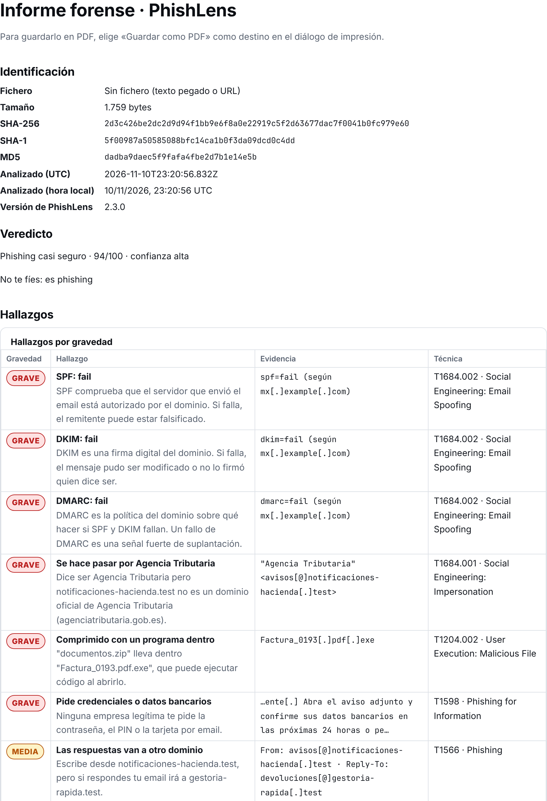

# Informe forense

«Exportar → Informe forense» abre un diálogo con un campo de **notas del analista** (opcional, 5.000 caracteres como mucho) y dos salidas con el mismo contenido:

- **Guardar como PDF**: abre el diálogo de impresión del navegador; elige «Guardar como PDF» como destino. Cada página lleva al pie el SHA-256 del correo y su número.
- **Descargar JSON**: `phishlens-forense-AAAA-MM-DD.json` (fecha en UTC), con `reportSha256` al final.

Si el historial está activado, las notas se guardan con el análisis y vuelven al abrirlo otra vez desde «Historial».

## Contenido, en este orden

| Sección | Qué lleva |
| --- | --- |
| Identificación | Nombre del fichero, tamaño en bytes, SHA-256, SHA-1 y MD5 de los bytes del fichero (o del texto analizado en UTF-8 si no hay fichero suelto), de qué se han sacado, fecha del análisis en UTC y en hora local, versión de PhishLens. Desde el historial: solo el SHA-256 guardado y la fecha en que se guardó |
| Veredicto | Nivel, etiqueta, puntuación, confianza y la frase del modo sencillo |
| Hallazgos | Ordenados por gravedad (alta, media, baja, info), con su evidencia defanged y su técnica ATT&CK |
| Autenticación | SPF, DKIM y DMARC con su estado, resultado y detalle |
| Cronología | Fecha del correo y saltos `Received` en orden de llegada, marcando los que van atrás en el tiempo |
| IOCs | Agrupados por tipo y defanged |
| Adjuntos | Nombre, tipo declarado y real, tamaño, SHA-256, SHA-1, MD5 y lo visto por dentro |
| URLs | Una por enlace distinto (100 como mucho), con el destino final y la cadena de saltos defanged |
| Notas del analista | Solo si hay notas; texto tal cual, nunca HTML |
| Límites | Lo que PhishLens no hace (DNS, reputación, flujos comprimidos de los PDF) |

## Comprobar que el JSON no se ha tocado

`reportSha256` es el SHA-256 de `JSON.stringify(informe, null, 2)` sin ese campo. Desde la carpeta del fichero:

```bash
node -e 'const f=require("fs").readFileSync(process.argv[1],"utf8");const {reportSha256:h,...b}=JSON.parse(f);console.log(require("crypto").createHash("sha256").update(JSON.stringify(b,null,2)).digest("hex")===h?"OK":"MODIFICADO")' phishlens-forense-2026-11-10.json
```

Para comprobar que el informe es del correo que tienes: si «Hashes de» dice «Los bytes del fichero tal cual», `sha256sum correo.eml` da el SHA-256 de «Identificación», también con BOM o en Latin-1. Para texto pegado, un correo de un lote o un informe abierto desde el historial, los hashes son los del texto analizado en UTF-8 y pueden no coincidir con el fichero original.

El hash detecta cambios, no firma: quien edite el JSON puede recalcularlo. Guarda el hash aparte (en el ticket, por ejemplo) si necesitas cadena de custodia.


